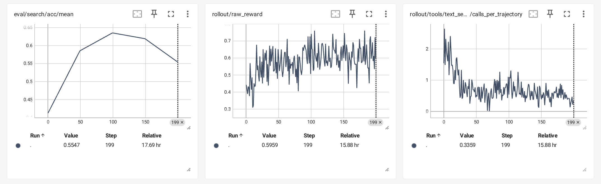
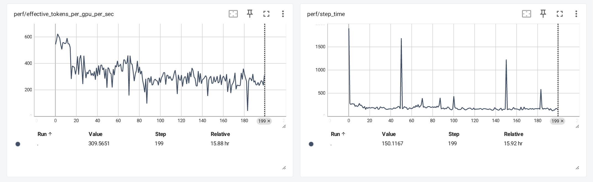
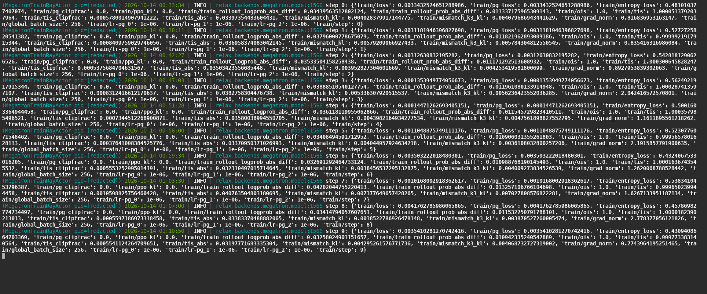

# DeepEyes-V2 × Search-R1：实现与训练复盘

本分支 `study/deepeyes-v2-search-r1` 用于个人开源项目复盘、简历与面试准备。代码基于实际实验使用的`e5e1df624e8b0ea635b6f2f8a5c41c83c33958e0`，保留Task 10搜索后端实现；新增材料不向上游发PR，也不改变现有贡献PR的分支。

**完成真实Search-R1接入后的200次GRPO更新，Search固定留出验证准确率41.26%→最佳63.53%（100步，+22.27个百分点）；同一验证条件下文本检索调用3.128→1.079次/轨迹，减少65.5%。** 200步最终准确率55.47%，按预先固定的主指标选择100步best。

| 完成更新        | Search准确率 | 格式合格率 | 文本调用/轨迹 |
| --------------- | -----------: | ---------: | ------------: |
| baseline        |       41.26% |     63.23% |         3.128 |
| 50              |       58.54% |     94.04% |         0.825 |
| **100（best）** |   **63.53%** | **97.17%** |     **1.079** |
| 150             |       61.91% |     99.32% |         0.707 |
| 200（final）    |       55.47% |     99.17% |         0.402 |

准确率口径为固定256题×8采样的平均答案正确率，非pass@8；该留出集用于选checkpoint，称验证集。实验验证真实工具训练闭环，不等于无检索消融、独立盲测或原论文完整复现。

搜索后端贡献 [PR #342](https://github.com/redai-studio/Relax/pull/342) 已于2026-10-16合并到上游。[合并状态与版本记录](evidence/contribution-status.json)明确区分历史训练基准与最终PR版本；当前个人归档分支不属于该PR。

## 阅读导航

首次阅读建议按 **[项目概述](docs/PROJECT.md) → [结果分析](docs/RESULTS.md) → [面试材料](docs/INTERVIEW.md)** 的顺序。配置、代码和日志按下表查阅，无需逐份通读。

| 目的                                    | 文档                                     |
| --------------------------------------- | ---------------------------------------- |
| 快速理解背景、个人贡献、技术链路        | [项目概述](docs/PROJECT.md)              |
| 模型/数据/GRPO/奖励/并行及默认配置差异  | [实验设计](docs/EXPERIMENT.md)           |
| 效果、性能、工具行为、best100与final200 | [结果分析](docs/RESULTS.md)              |
| 预检、SM优化、恢复、补评估的工程过程    | [执行与修复](docs/PROCESS.md)            |
| 准备简历与1/3分钟介绍、常见追问         | [面试材料](docs/INTERVIEW.md)            |
| 复用哪些实现、如何准备环境与配方        | [实现与复现边界](docs/IMPLEMENTATION.md) |
| Judge选择与有限预检                     | [Judge说明](docs/JUDGE.md)               |
| 数据、日志与配置逐项核对                | [证据索引](docs/EVIDENCE.md)             |

## 原生截图





<details>
<summary>查看前十步原生训练日志</summary>



</details>

截图为真实TensorBoard/终端截图，仅按需求裁边；未重新绘图、插值或修改指标。日志身份已脱敏。原生99/199分别对应完成100/200次更新。曲线Smoothing=0，显示保留异常值。

## 仓库内保存什么

`configs/`保存无部署身份的固定实验配置；`data/`保存完整评估、200更新宽表、所有原生标量的无损gzip；`evidence/`保存脱敏日志和恢复/补评估证据；`implementation/`保存历史运行的关键实验辅助代码。训练recipe位于仓库原生`scripts/training/multimodal/`目录。

不提交大模型、数据集、完整checkpoint、主机命名的原始events、全量私有日志或平台专用资源管理脚本。私有原件另存并保留hash索引；脱敏记录明确标注路径变量化，不冒充未经处理的完整原件。

检查本分支证据包（只读，不启动训练）：

```bash
python experiments/deepeyes-v2-search-r1/tools/verify_artifacts.py
```

记录的是2026-10-13至10-14的既有实验，分支归档整理于2026-10-24；本次未追加训练或评估。更换平台、依赖或并发可能改变随机采样，不承诺逐位复现。
