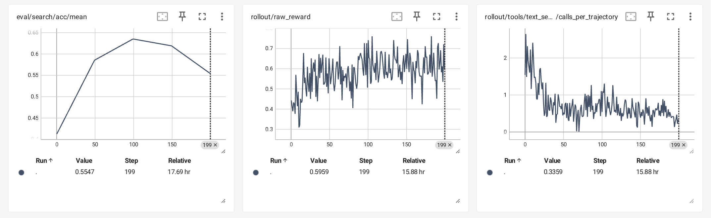
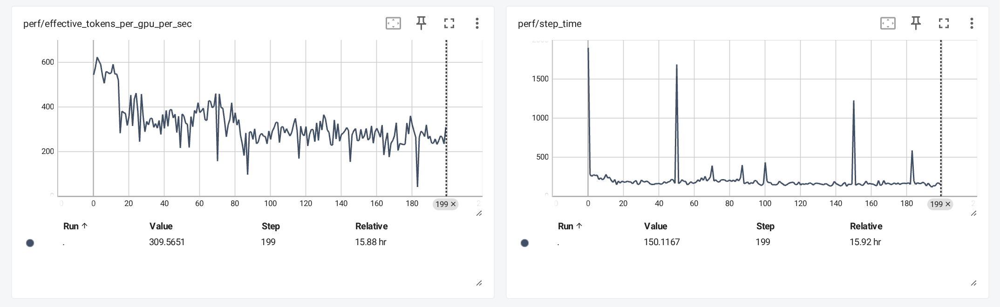

# 结果分析：效果、行为与性能

## 主结果

| 完成更新数 | 原生eval编号 | 正确/计划采样 | Search准确率 | 综合reward | 格式合格率 | 文本调用/轨迹 | 图片检索使用率 |
| ---------- | ------------ | ------------- | ------------ | ---------- | ---------- | ------------- | -------------- |
| 0          | 0            | 845/2048      | 41.26%       | 0.42939    | 63.23%     | 3.128         | 42.68%         |
| 50         | 49           | 1199/2048     | 58.54%       | 0.61766    | 94.04%     | 0.825         | 80.91%         |
| 100        | 99           | 1301/2048     | 63.53%       | 0.65602    | 97.17%     | 1.079         | 86.62%         |
| 150        | 149          | 1268/2048     | 61.91%       | 0.65328    | 99.32%     | 0.707         | 82.28%         |
| 200        | 199          | 1136/2048     | 55.47%       | 0.61357    | 99.17%     | 0.402         | 57.96%         |

baseline原生eval0对应零次更新，训练native step0则是第一次更新；其后49/99/149/199分别对应完成50/100/150/200次更新。引用数字时优先用“完成更新数”，避免错一位。

最佳是 **100步**：1301/2048=63.525390625%，相对baseline845/2048提高22.265625个百分点；相对提升约54.0%，简历优先使用更直观的+22.27pp。最终200步1136/2048=55.46875%，比baseline高14.21pp，比best低8.06pp。

## 如何解读

1. **端到端链路通过实际训练验证。** 200个有效更新点和51,200条接受轨迹，五轮Search评估完整；真实retriever调用进入Agent observation、回答与奖励计算，再完成策略更新。这比只有HTTP单测更有证明力。
2. **协议适应的收益明显。** 格式合格率63.23%→97.17%，减少未给有效最终答案等错误。格式合格回答中的正确率baseline64.71%、best65.28%，显示总准确率提升包含大量协议完成率改善。这是不同回答子集的描述性统计，不能精确分解因果收益。
3. **调用开销下降，不能单独等同于策略更优。** best平均文本检索从3.128降为1.079（减少65.5%），同时答案准确率提高；可以报告“提升准确率并减少平均调用”。后期到0.402次时准确率也下降，不能声称调用越少越好。
4. **后段回落是真实结果，选择best合理。** 100→200步图片检索使用率86.62%→57.96%；可能出现过度避免有益搜索等现象，但奖励偏好、样本、采样随机性、Judge局限等未做消融，不能确定唯一原因，也不称已稳定收敛。
5. **补评估未重新训练。** 独立BF16推理评估只补齐final模型分数，未更新参数。固定16题中，导出前原生200步和补评估的图片检索使用率同为57.81%，支持策略变化在导出前存在；不证明每条随机答案完全等价。

VStar按计划分母依次为83.84%、83.25%、81.54%、82.85%、83.77%；前3轮分别缺20/26/46条。有效样本分母见 [evaluation.csv](../data/evaluation.csv)。VStar没有明确改善；它不支持“所有视觉任务全面提高”。

## 曲线的读法

三张卡依次为：留出验证答案准确率、训练raw reward、训练平均文本工具调用次数。评估每50步，因此仅五点；训练reward和工具指标逐步记录，共200个有效步。图为原生TensorBoard，Smoothing=0，未忽略异常值。平滑线可能让峰值滞后到150步；选模型使用原始Value，不能用平滑峰值或`eval/search`综合reward。

截图底部展示选中的最终点199，并不代表图上最高点；best100需要读取99的原始准确率。图标题截断为`text_se...`的卡是文本检索平均调用，不是成功率。

## 训练健康度

global batch始终256；loss、grad norm、entropy和mismatch KL全部为有限值，最后grad norm1.6742；个别梯度峰值最高18.19后恢复，原始曲线保留。RL的policy loss不以像监督学习那样单调下降为目标，loss接近零或变号不能独立证明学好/学坏。

接受训练样本scorer异常0；文本检索36,962次中失败11次，约0.030%。这不是“所有生成、图片工具、Judge都绝无问题”：原生会话替补、缓存缺失及历史路由异常见过程记录。五轮Search验证文本retriever失败/空结果统计为0。

## 性能

| 指标                   | 普通步中位数 | 普通步均值 |
| ---------------------- | -----------: | ---------: |
| step time              |     168.54秒 |   180.95秒 |
| rollout                |      69.61秒 |    79.43秒 |
| train                  |      65.93秒 |    68.94秒 |
| update weights         |      15.04秒 |    15.08秒 |
| effective tokens/GPU/s |       303.94 |     321.28 |

普通步口径排除native `0,49,50,99,100,149,150,199`，共192步，用于避开初始化、恢复和周期边界；保留全量CSV，不能用这些统计隐藏全程耗时。各阶段中位数相加不等于总耗时中位数。截图最终点为309.5651tokens/GPU/s和150.1167秒，它们不是上表整体中位数。

从2026-10-13 23:55:36启动至10-14 18:11:28最终评估完成，墙钟约 **18小时16分钟**，包含路由失败、恢复后重复计算和补评估。权重HDFS上传不计入训练完成时间。不能将18小时16分直接用于推算纯训练吞吐。

训练GPU采样显存峰值68.44GiB；严格按requested_end−requested_start=7200秒核算，完整两小时SM窗口64份，最低20.78%、最高31.79%。旧报告写65份，本次以逐份时间范围重新核算的CSV为准，原报告保持原样。窗口相互重叠，只说明保存的这些窗口超过平台20%门槛；不是独立重复实验，也不保证每个时刻或任何新运行都达标。训练卡未叠加合成保活负载；性能优化前后没有严格同样本A/B，因此不编造吞吐提升百分比。

## 模型选择与结论范围

按照固定Search验证准确率，四个候选50/100/150/200中选100步，final200作为完成预算的终态模型保留。验证集用于选型，不称独立测试集；若后续声称泛化测试成绩，应再对未参与选型的数据做一次评测。

本轮最适合展示的结论：**完成搜索后端接入、标准化端到端RL训练与评估；在固定Search验证集取得明确提升，减少平均文本调用，并完成可追溯的恢复与模型选择。** 当前证据不支持将全部收益归因于Search-R1、宣称多seed稳定性或精确复现原论文成绩。
